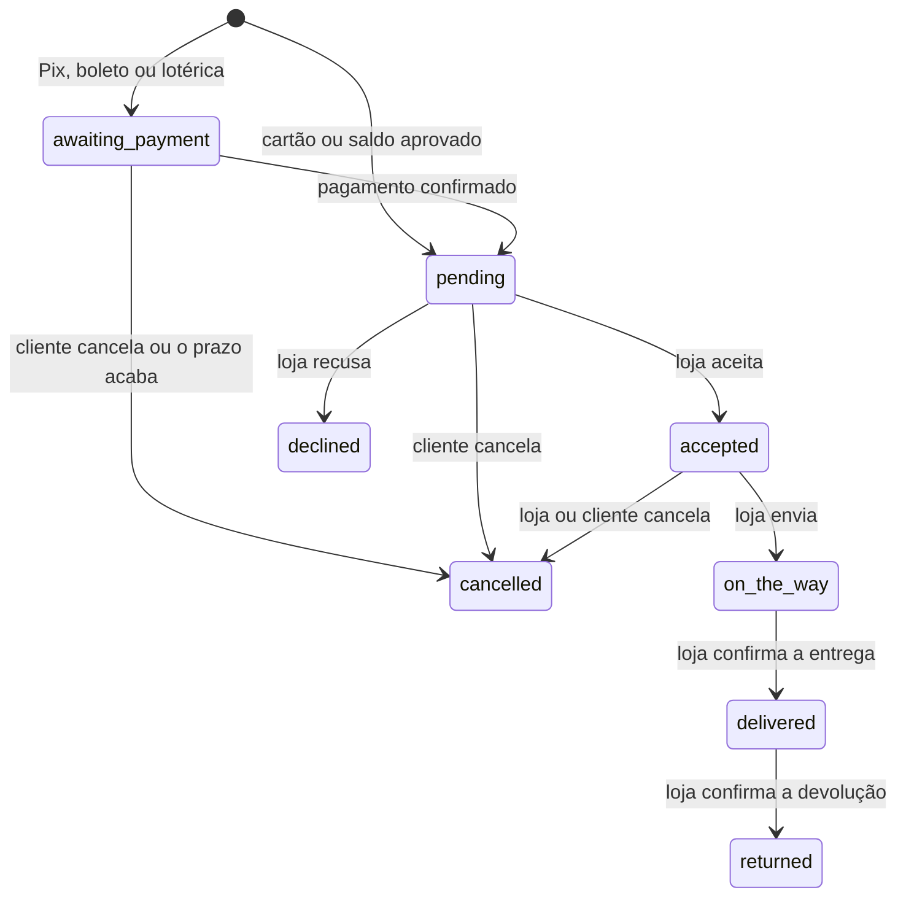

# Obi Ágil — API

API REST do Obi Ágil, o marketplace de aluguel de equipamentos de obra. É um servidor Express com PostgreSQL que atende o app web e qualquer outro cliente (app nativo, integrações).

- **Base**: `https://api.obiagil.com.br/api` em produção. Em desenvolvimento, `http://localhost:3001/api`, e o Vite repassa `/api` e `/uploads` para o servidor.
- **Página da API**: `https://api.obiagil.com.br`, só com a sessão aberta no app. Não há Swagger público.
- **OpenAPI 3.1**: [`/api/openapi.json`](http://localhost:3001/api/openapi.json), com cópia em [`docs/openapi.json`](openapi.json) para importar no Postman ou Insomnia.
- **Este arquivo**: a parte de cima é escrita à mão; a [referência dos endpoints](#referência-dos-endpoints) e os [modelos](#modelos) são gerados do código com `npm run docs`, então sempre batem com as rotas.

## Sumário

- [Convenções](#convenções)
- [Autenticação](#autenticação)
- [Erros](#erros)
- [Limites de requisição](#limites-de-requisição)
- [Pagamentos (Mercado Pago)](#pagamentos-mercado-pago)
- [Ciclo do pedido](#ciclo-do-pedido)
- [Atualizações ao vivo (SSE)](#atualizações-ao-vivo-sse)
- [Webhook do Mercado Pago](#webhook-do-mercado-pago)
- [Fotos](#fotos)
- [Exemplo completo com curl](#exemplo-completo-com-curl)
- [Referência dos endpoints](#referência-dos-endpoints)
- [Modelos](#modelos)

## Convenções

| Assunto | Regra |
| --- | --- |
| Formato | JSON em UTF-8 nos dois sentidos. Corpo de até 200 KB (fotos até 10 MB em `/uploads`). |
| Cabeçalho obrigatório | Toda requisição `POST`, `PUT`, `PATCH` e `DELETE` precisa de `X-Requested-With` (qualquer valor). Sem ele a resposta é `403 missing_header`. Isso impede que outro site use a sessão do navegador (CSRF). O webhook do Mercado Pago é a exceção. |
| Dinheiro | Reais, como número com até 2 casas: `85.5` é R$ 85,50. O servidor guarda em centavos. |
| Datas | Dia do calendário em `YYYY-MM-DD` ("hoje" é no fuso de São Paulo). Instantes (`createdAt`, `at`, `expiresAt`) em milissegundos desde 1970. |
| Ids | UUID v4 em texto. |
| Celular | Celular brasileiro com DDD. Aceita qualquer pontuação e `+55` na entrada; as respostas trazem só os 11 dígitos (`11987654321`). |
| CPF | Com ou sem pontuação; os dígitos verificadores são conferidos. |
| Fotos | Caminhos devolvidos por `POST /uploads` (`/uploads/<id>.webp`) ou imagens da galeria do app (`/img/...`). URLs externas são recusadas. |
| Coordenadas | `lat`/`lng` em graus decimais (WGS 84). |

## Autenticação

A sessão é um cookie `oa_session` (`HttpOnly`, `SameSite=Lax`, `Secure` em HTTPS) que vale 30 dias e se renova sozinho com o uso. O servidor guarda só o hash do token.

- Abrem sessão: `POST /auth/register`, `POST /auth/login`, `POST /auth/phone/verify` (quando o celular já tem conta), `POST /auth/phone/register` e `POST /auth/password/reset`.
- `POST /auth/logout` encerra a sessão atual. Trocar a senha encerra as outras sessões da conta.
- `GET /auth/me` devolve a conta logada e, para empresas, a loja. Sem sessão: `401`.
- Há dois papéis: `customer` (quem aluga) e `business` (locadora). Rotas de um papel respondem `403 forbidden` ao outro.
- Fora do navegador, guarde o cookie do `Set-Cookie` e mande de volta em cada requisição (no curl: `-c cookies.txt -b cookies.txt`).

### Criar conta e entrar

| Jeito | Passos |
| --- | --- |
| E-mail e senha | `POST /auth/register` com `role`, `name`, `email`, `password` (8 a 128 caracteres), `address` e, para empresas, `business { name, category }`. Responde `201` com a sessão aberta. Depois, `POST /auth/login`. |
| Celular com código por SMS | 1. `POST /auth/phone/start { phone }` manda o código (6 dígitos, vale 10 minutos).<br>2. `POST /auth/phone/verify { phone, code }`. Se o número já tem conta, a resposta é `{ "status": "signed_in", user, business }` e a sessão já está aberta. Se não, é `{ "status": "new", ticket }`.<br>3. `POST /auth/phone/register` com o `ticket` (vale 30 minutos, uso único) e os mesmos dados do cadastro, sem senha. |
| Esqueci a senha | `POST /auth/password/forgot { email }` sempre responde `202`, exista ou não a conta. O e-mail traz `APP_URL/?reset=TOKEN`, que vale 30 minutos e uma vez só. `POST /auth/password/reset { token, password }` troca a senha e abre a sessão. |
| Contas só com celular | Podem criar uma senha em `POST /me/password` (precisa de e-mail no perfil) e passar a entrar também com e-mail. |

O código por SMS pode ser pedido de novo depois de 30 segundos (antes disso: `429 resend_too_soon`, com `details.retryIn`), até 5 vezes por hora para o mesmo número. Cada código aceita 5 tentativas.

**SMS e e-mail em desenvolvimento.** Sem Twilio e SMTP configurados, o código do SMS e o link de troca de senha aparecem no terminal da API (linhas `[sms]` e `[mail]`) e `GET /config` informa `mode: "console"`. Em produção, sem essas credenciais, entrar pelo celular e recuperar a senha ficam desligados (`mode: "disabled"`, respostas `503`).

Exemplo de cadastro de locadora:

```json
POST /api/auth/register
{
  "role": "business",
  "name": "Marcos Teixeira",
  "email": "marcos@belavista.com.br",
  "password": "BelaVista#2026",
  "address": { "label": "Rua Augusta, 900", "detail": "Consolação, São Paulo", "lat": -23.5535, "lng": -46.6564 },
  "business": { "name": "Locadora Bela Vista", "category": "concreto" }
}
```

## Erros

Todo erro tem o mesmo formato. `message` já vem em português, pronta para mostrar a quem usa o app.

```json
{ "error": { "code": "validation_error", "message": "Digite seu nome completo.", "details": [{ "in": "body", "path": "name", "message": "Digite seu nome completo." }] } }
```

| Status | Códigos | Quando |
| --- | --- | --- |
| 400 | `invalid_json`, `invalid_start`, `address_required`, `out_of_range`, `invalid_cpf`, `email_required`, `phone_required`, `invalid_password`, `invalid_code`, `code_expired`, `invalid_phone`, `ticket_expired`, `reset_expired`, `file_required`, `invalid_image`, `too_many_items` | Pedido que não dá para atender como está. |
| 401 | `unauthorized`, `invalid_credentials`, `invalid_signature` | Sem sessão, e-mail ou senha errados, assinatura de webhook inválida. |
| 402 | `payment_rejected` | Cartão recusado. `details.statusDetail` traz o motivo do Mercado Pago; nenhum pedido é criado. |
| 403 | `forbidden`, `missing_header` | Papel errado ou falta o cabeçalho `X-Requested-With`. |
| 404 | `not_found` | Não existe ou não é seu. |
| 409 | `email_taken`, `phone_taken`, `unavailable_dates`, `item_paused`, `invalid_transition`, `not_returned`, `already_reviewed`, `chat_closed` | Conflito com o estado atual. |
| 413 | `file_too_large`, `body_too_large` | Foto acima de 10 MB ou corpo acima de 200 KB. |
| 422 | `validation_error`, `card_invalid`, `payment_invalid`, `installments_failed` | Dados fora do formato (`details` lista cada campo) ou recusados pelo Mercado Pago. |
| 429 | `rate_limited`, `resend_too_soon` | Muitas requisições. |
| 500 | `internal_error` | Erro inesperado; o detalhe fica só no log do servidor. |
| 502 | `payment_failed` | O Mercado Pago não respondeu. |
| 503 | `payments_unavailable`, `sms_unavailable`, `sms_failed`, `mail_unavailable` | Serviço externo não configurado ou fora do ar. |

## Limites de requisição

| Grupo | Limite por IP |
| --- | --- |
| Toda a API | 600 por minuto |
| Cadastro, entrada, códigos e senhas | 40 a cada 15 minutos |
| Envio de código por SMS | 15 por hora (e 5 por hora para o mesmo número) |
| E-mail de troca de senha | 10 por hora |
| Fotos | 150 por hora |

As respostas trazem os cabeçalhos `RateLimit` e `RateLimit-Policy`. Acima do limite: `429 rate_limited`. Com `NODE_ENV=test` os limites ficam desligados.

## Pagamentos (Mercado Pago)

Os pagamentos usam o Mercado Pago no Brasil: cartão de crédito (Visa, Mastercard, Elo, American Express, Hipercard, Cabal e Diners, em até 12x), cartão de débito (Visa, Mastercard, Elo e Cabal, à vista), Pix, boleto Bradesco, lotérica e saldo da conta Mercado Pago. O número do cartão e o código de segurança nunca passam pelo servidor do Obi Ágil; o app troca os dados do cartão por um token de uso único com o MercadoPago.js.

`GET /config` diz se os pagamentos estão ligados e traz a chave pública: `payments: { enabled, provider: "mercadopago", publicKey, maxInstallments: 12 }`.

### Valores do pedido

O servidor calcula tudo; o app só mostra.

| Parte | Cálculo |
| --- | --- |
| `rent` | preço por dia × dias |
| `deliveryFee` | taxa de entrega da loja, só quando `mode = "delivery"` |
| `serviceFee` | 5% do aluguel |
| `deposit` | caução do equipamento, devolvida quando a loja confirma a devolução |
| `total` | soma de tudo; é o valor cobrado |

A loja recebe aluguel + entrega.

### Cartão de crédito e de débito

1. Carregue `https://sdk.mercadopago.com/js/v2` e crie `new MercadoPago(publicKey)`. Monte os campos seguros `cardNumber`, `expirationDate` e `securityCode`.
2. Quando os primeiros dígitos do cartão aparecerem, chame `GET /payments/installments?amount=TOTAL&bin=PRIMEIROS_6_A_8&type=credit` (ou `type=debit`). A resposta traz `paymentMethodId` (bandeira, como `visa` ou `debvisa`), `issuerId` (banco) e as parcelas. Débito volta só 1x.
3. Gere o token: `mp.fields.createCardToken({ cardholderName, identificationType: "CPF", identificationNumber })`.
4. `POST /orders` com `payment: { method: "card", token, paymentMethodId, issuerId, installments }`.
   - Aprovado: `201` com o pedido em `pending` (já aparece para a loja).
   - Recusado: `402 payment_rejected`, com uma mensagem explicando o motivo. Nenhum pedido é criado.

**Cartões salvos.** `POST /payment-methods { token }` guarda o cartão no cliente do Mercado Pago (precisa de e-mail no perfil). Para pagar com ele, gere o token com `createCardToken({ cardId })` (o campo do código de segurança continua necessário) e mande `savedCardId` no pedido. `PATCH /payment-methods/{id}` torna o cartão padrão e `DELETE` remove também do Mercado Pago.

### Pix

1. `POST /orders` com `payment: { method: "pix" }` responde `201` com o pedido em `awaiting_payment` e `payment.pix`:
   - `qrCode`: o Pix copia e cola;
   - `qrCodeBase64`: a imagem PNG do QR code;
   - `ticketUrl`: página do Mercado Pago com o QR;
   - `expiresAt`: fim do prazo (30 minutos).
2. Enquanto espera, o equipamento fica reservado e a loja ainda não vê o pedido.
3. Quando o Pix cai, o pedido passa para `pending` e chega um evento `order` pelo [SSE](#atualizações-ao-vivo-sse). O servidor fica sabendo pelo webhook, por uma checagem automática a cada 30 segundos ou por `POST /orders/{id}/payment/refresh` (botão "Já paguei").
4. Sem pagamento no prazo, o pedido é cancelado sozinho.

### Boleto, lotérica e saldo Mercado Pago

`POST /orders` com `payment.method` em `boleto`, `pec` ou `account_money`. Boleto e lotérica exigem CPF no perfil (ou em `payer.cpf`).

- `boleto`: pedido em `awaiting_payment` por 3 dias, com `payment.ticket` (`barcode` é a linha digitável, `url` abre o boleto). A loja só vê o pedido depois que o banco compensar.
- `pec`: igual ao boleto, para pagamento em dinheiro numa casa lotérica. `payment.ticket.barcode` é o código.
- `account_money`: cobra o saldo da conta Mercado Pago do mesmo e-mail. Aprovado, o pedido já nasce `pending`. Se o Mercado Pago ainda pedir confirmação, o pedido fica `awaiting_payment` e `payment.ticket.url` abre a tela deles.

O CPF e o e-mail do pagador vêm do perfil. Se faltarem, mande `payer: { email, cpf }` no próprio pedido: eles são salvos na conta.

### Conta da loja

Cada locadora conecta a própria conta em `POST /my/business/mercadopago`, que devolve a URL de autorização do Mercado Pago. Depois do aceite, o navegador volta para `GET /mercadopago/callback`. Os pedidos seguintes são criados com o token dessa loja e `application_fee` igual à taxa de serviço, então o aluguel cai na conta da loja e a taxa fica com a plataforma. Sem a conexão, o pagamento usa a conta do aplicativo. `business.mercadoPagoConnected` diz se a loja já autorizou.

### Estornos

| Situação | Estorno |
| --- | --- |
| Loja recusa (`declined`) ou alguém cancela um pedido pago (`cancelled`) | Tudo o que foi pago |
| Loja confirma a devolução (`returned`) | A caução |
| Cliente cancela um Pix, boleto ou lotérica ainda não pago | Nada a estornar; o pagamento é cancelado no Mercado Pago |

Se o Mercado Pago falhar na hora, o estorno fica pendente e o servidor tenta de novo a cada 30 segundos. `payment.refunded` mostra quanto já voltou.

### Modo de teste

Com `NODE_ENV=test` e `PAYMENTS_DRIVER=fake` o servidor usa um Mercado Pago de mentira, que nunca é ativado fora desse modo:

- tokens de cartão terminados em `reject` são recusados;
- `POST /api/test/payments/{id}/approve` marca um Pix, boleto ou lotérica como pago.

É assim que `npm run test:api` testa os pagamentos sem cobrar ninguém.

## Ciclo do pedido



`POST /orders/{id}/status { status }` move o pedido. Cada lado só pode dar os passos abaixo; qualquer outro responde `409 invalid_transition`.

| Quem | De | Para |
| --- | --- | --- |
| Loja | `pending` | `accepted` ou `declined` |
| Loja | `accepted` | `on_the_way` ou `cancelled` |
| Loja | `on_the_way` | `delivered` |
| Loja | `delivered` | `returned` |
| Cliente | `awaiting_payment`, `pending` ou `accepted` | `cancelled` |

- **Disponibilidade**: um equipamento com quantidade N aceita até N pedidos ativos (`awaiting_payment` a `delivered`) com datas que se cruzam. Acima disso: `409 unavailable_dates`. Pedidos podem começar de hoje até 60 dias à frente e durar de 1 a 30 dias.
- **Entrega**: o endereço precisa estar dentro do raio de entrega da loja (`radiusKm`); senão, `400 out_of_range`. Na retirada (`mode = "pickup"`) o endereço do pedido é o da loja.
- **Conversa**: `GET/POST /orders/{id}/messages` depois do pagamento. `unread` em cada pedido conta as mensagens não lidas por quem pergunta; `POST /orders/{id}/read` zera.
- **Avaliação**: uma por pedido, de 1 a 5 estrelas, depois de `returned` (`POST /orders/{id}/review`). Atualiza a nota da loja.
- **Listas**: o cliente vê os pedidos que fez, menos os pagamentos cancelados antes de cair. A loja vê os pedidos pagos.

## Atualizações ao vivo (SSE)

`GET /api/events` mantém uma conexão `text/event-stream` aberta para a conta logada.

| Evento | Dados | Quando |
| --- | --- | --- |
| `order` | [Order](#model-order) do ponto de vista de quem recebe | Qualquer mudança num pedido seu: pagamento, etapa, estorno, avaliação. |
| `message` | [Message](#model-message) | Mensagem nova num pedido seu, dos dois lados. |
| `ping` | `{}` | A cada 25 segundos, para manter a conexão viva. |

```js
const events = new EventSource("/api/events");
events.addEventListener("order", (event) => {
  const order = JSON.parse(event.data);
  // atualize o pedido na tela
});
events.addEventListener("message", (event) => {
  const message = JSON.parse(event.data);
});
```

Se nada chegar por mais de um minuto, a conexão caiu sem aviso (reinício do servidor, proxy, troca de rede no celular): feche, abra outra e recarregue `GET /orders` para pegar o que passou nesse tempo. O app web já faz isso sozinho.

## Webhook do Mercado Pago

No painel do Mercado Pago, em Webhooks, cadastre `PUBLIC_URL/api/webhooks/mercadopago` com o evento **Pagamentos**. O Mercado Pago só chama endereços HTTPS.

- Com `MP_WEBHOOK_SECRET` configurado, a assinatura `x-signature` é conferida (HMAC SHA-256 de `id:{data.id};request-id:{x-request-id};ts:{ts};`); assinatura errada recebe `401`.
- Toda notificação fica gravada na tabela `webhook_events`.
- O conteúdo da notificação nunca muda nada sozinho: o servidor sempre consulta o pagamento de novo na API do Mercado Pago.
- Sem `PUBLIC_URL` (desenvolvimento), a checagem automática a cada 30 segundos faz o mesmo papel.

## Fotos

`POST /uploads?kind=...` recebe `multipart/form-data` com o campo `file` (JPG, PNG, WebP ou GIF, até 10 MB) e devolve `{ "url": "/uploads/<id>.webp" }`, que você usa em `photo`, `logo`, `cover` ou `image`.

| `kind` | Uso | Tamanho final |
| --- | --- | --- |
| `avatar` | foto de perfil | 512 × 512 |
| `logo` | logo da loja | 512 × 512 |
| `cover` | capa da loja | 1600 × 900 |
| `item` | foto do equipamento | até 1200 px no maior lado |

A foto é girada conforme o EXIF, perde os metadados (incluindo localização) e vira WebP. Os arquivos ficam em `server/storage/uploads` e são servidos em `/uploads/...` com cache longo.

## Exemplo completo com curl

```bash
API=http://localhost:3001/api
H='-H Content-Type:application/json -H X-Requested-With:curl'

# 1. Cliente cria a conta (a sessão fica em cliente.txt)
curl -s -c cliente.txt $H -X POST $API/auth/register -d '{
  "role": "customer", "name": "Ana Souza", "email": "ana@example.com", "password": "uma-senha-forte",
  "address": { "label": "Avenida Paulista, 1578", "detail": "Bela Vista, São Paulo", "lat": -23.5614, "lng": -46.6559 }
}'

# 2. Lojas e equipamentos num raio de 40 km
curl -s -b cliente.txt "$API/explore?lat=-23.5614&lng=-46.6559"

# 3. Busca sem acento e por preço
curl -s -b cliente.txt "$API/search?lat=-23.5614&lng=-46.6559&q=betoneira&sort=price"

# 4. Pedido com Pix, retirada na loja
curl -s -b cliente.txt $H -X POST $API/orders -d '{
  "itemId": "ID_DO_EQUIPAMENTO", "start": "2026-11-20", "days": 2, "mode": "pickup",
  "payment": { "method": "pix" }, "payer": { "cpf": "529.982.247-25" }
}'

# 5. Acompanhar ao vivo
curl -N -b cliente.txt $API/events
```

No PowerShell use `curl.exe` e passe o JSON com `--data-binary "@arquivo.json"`.

<!-- BEGIN GENERATED: npm run docs -->

## Referência dos endpoints

52 endpoints, gerados de `server/routes`. Todos ficam em `/api`.

- **Meta**: [GET /config](#get-api-config), [GET /health](#get-api-health)
- **Auth**: [POST /auth/register](#post-api-auth-register), [POST /auth/login](#post-api-auth-login), [POST /auth/phone/start](#post-api-auth-phone-start), [POST /auth/phone/verify](#post-api-auth-phone-verify), [POST /auth/phone/register](#post-api-auth-phone-register), [GET /auth/me](#get-api-auth-me), [POST /auth/logout](#post-api-auth-logout), [POST /auth/password/forgot](#post-api-auth-password-forgot), [POST /auth/password/reset](#post-api-auth-password-reset)
- **Me**: [POST /me/password](#post-api-me-password), [PATCH /me](#patch-api-me), [POST /me/phone/start](#post-api-me-phone-start), [POST /me/phone/verify](#post-api-me-phone-verify), [DELETE /me/phone](#delete-api-me-phone), [POST /me/addresses](#post-api-me-addresses), [PUT /me/addresses/active](#put-api-me-addresses-active), [DELETE /me/addresses/{id}](#delete-api-me-addresses-id), [GET /me/favorites](#get-api-me-favorites), [PUT /me/favorites/{kind}/{id}](#put-api-me-favorites-kind-id), [DELETE /me/favorites/{kind}/{id}](#delete-api-me-favorites-kind-id), [POST /me/searches](#post-api-me-searches), [DELETE /me/searches](#delete-api-me-searches)
- **Explore**: [GET /explore](#get-api-explore), [GET /search](#get-api-search), [GET /businesses/{id}](#get-api-businesses-id), [GET /items/{id}](#get-api-items-id)
- **My business**: [PATCH /my/business](#patch-api-my-business), [POST /my/business/mercadopago](#post-api-my-business-mercadopago), [GET /mercadopago/callback](#get-api-mercadopago-callback), [GET /my/items](#get-api-my-items), [POST /my/items](#post-api-my-items), [PATCH /my/items/{id}](#patch-api-my-items-id), [DELETE /my/items/{id}](#delete-api-my-items-id)
- **Orders**: [GET /orders](#get-api-orders), [POST /orders](#post-api-orders), [GET /orders/{id}](#get-api-orders-id), [POST /orders/{id}/status](#post-api-orders-id-status), [POST /orders/{id}/payment/refresh](#post-api-orders-id-payment-refresh), [GET /orders/{id}/messages](#get-api-orders-id-messages), [POST /orders/{id}/messages](#post-api-orders-id-messages), [POST /orders/{id}/read](#post-api-orders-id-read), [POST /orders/{id}/review](#post-api-orders-id-review)
- **Payments**: [GET /payment-methods](#get-api-payment-methods), [POST /payment-methods](#post-api-payment-methods), [PATCH /payment-methods/{id}](#patch-api-payment-methods-id), [DELETE /payment-methods/{id}](#delete-api-payment-methods-id), [GET /payments/installments](#get-api-payments-installments)
- **Uploads**: [POST /uploads](#post-api-uploads)
- **Events**: [GET /events](#get-api-events)
- **Webhooks**: [POST /webhooks/mercadopago](#post-api-webhooks-mercadopago)

## Meta

Configuração pública e saúde do servidor.

<a id="get-api-config"></a>

### GET `/api/config`

**Configuração pública do app** · Pública

O que está ligado neste servidor: pagamentos (e a chave pública do Mercado Pago), SMS e e-mail.

**Respostas**

| Código | Quando | Corpo |
| --- | --- | --- |
| 200 | Configuração | [PublicConfig](#model-publicconfig) |
| 4xx/5xx | Erro | [Error](#model-error) |


<a id="get-api-health"></a>

### GET `/api/health`

**Saúde do servidor** · Pública

**Respostas**

| Código | Quando | Corpo |
| --- | --- | --- |
| 200 | Servidor e banco respondendo | objeto, ver abaixo |
| 4xx/5xx | Erro | [Error](#model-error) |

Corpo da resposta 200:

| Campo | Tipo | Obrigatório | Descrição |
| --- | --- | --- | --- |
| `ok` | boolean | sim |  |
| `db` | boolean | sim |  |


## Auth

Cadastro, entrada com e-mail e senha ou celular e código SMS, recuperação de senha e sessão.

<a id="post-api-auth-register"></a>

### POST `/api/auth/register`

**Criar conta com e-mail e senha** · Pública

Cria a conta (e a loja, para empresas), salva o endereço e já abre a sessão.

**Corpo (JSON)**

| Campo | Tipo | Obrigatório | Descrição |
| --- | --- | --- | --- |
| `role` | [Role](#model-role) | sim |  |
| `name` | string | sim | 3 a 80 caracteres. |
| `address` | object | sim | Endereço da obra (cliente) ou da loja (empresa). |
| `address.label` | string | sim | Rua e número, ou nome do lugar. 1 a 120 caracteres. |
| `address.detail` | string | não | Bairro e cidade. Até 160 caracteres, padrão `""`. |
| `address.lat` | number | sim | De -90 a 90. |
| `address.lng` | number | sim | De -180 a 180. |
| `business` | object | não | Obrigatório quando role = business. |
| `business.name` | string | sim | 3 a 80 caracteres. |
| `business.category` | [Category](#model-category) | sim |  |
| `email` | string | sim |  |
| `password` | string | sim | 8 a 128 caracteres. |

**Respostas**

| Código | Quando | Corpo |
| --- | --- | --- |
| 201 | Conta logada | [Session](#model-session) |
| 4xx/5xx | Erro | [Error](#model-error) |


<a id="post-api-auth-login"></a>

### POST `/api/auth/login`

**Entrar com e-mail e senha** · Pública

**Corpo (JSON)**

| Campo | Tipo | Obrigatório | Descrição |
| --- | --- | --- | --- |
| `email` | string | sim |  |
| `password` | string | sim | 1 a 128 caracteres. |

**Respostas**

| Código | Quando | Corpo |
| --- | --- | --- |
| 200 | Conta logada | [Session](#model-session) |
| 4xx/5xx | Erro | [Error](#model-error) |


<a id="post-api-auth-phone-start"></a>

### POST `/api/auth/phone/start`

**Enviar código por SMS** · Pública

Envia um código de 6 dígitos para o celular. Serve para entrar e para criar conta: depois de conferir o código, /auth/phone/verify diz se o número já tem conta. Sem Twilio configurado, em desenvolvimento o código aparece no terminal da API.

**Corpo (JSON)**

| Campo | Tipo | Obrigatório | Descrição |
| --- | --- | --- | --- |
| `phone` | string | sim | Celular com DDD (11 dígitos). Pontuação e +55 são aceitos. |

**Respostas**

| Código | Quando | Corpo |
| --- | --- | --- |
| 202 | Código enviado | objeto, ver abaixo |
| 4xx/5xx | Erro | [Error](#model-error) |

Corpo da resposta 202:

| Campo | Tipo | Obrigatório | Descrição |
| --- | --- | --- | --- |
| `resendIn` | integer | sim | Segundos até poder pedir outro. |


<a id="post-api-auth-phone-verify"></a>

### POST `/api/auth/phone/verify`

**Conferir código do SMS** · Pública

Se o celular já tem conta, abre a sessão (status signed_in). Se não, devolve um ticket (status new) para /auth/phone/register, válido por 30 minutos.

**Corpo (JSON)**

| Campo | Tipo | Obrigatório | Descrição |
| --- | --- | --- | --- |
| `phone` | string | sim | Celular com DDD (11 dígitos). Pontuação e +55 são aceitos. |
| `code` | string | sim | Código de 6 dígitos recebido por SMS. |

**Respostas**

| Código | Quando | Corpo |
| --- | --- | --- |
| 200 | Código certo | ver abaixo |
| 4xx/5xx | Erro | [Error](#model-error) |

Corpo da resposta 200:

Formato 1:

| Campo | Tipo | Obrigatório | Descrição |
| --- | --- | --- | --- |
| `status` | `"signed_in"` | sim |  |
| `user` | [Me](#model-me) | sim |  |
| `business` | [Business](#model-business) \| null | sim |  |

Formato 2:

| Campo | Tipo | Obrigatório | Descrição |
| --- | --- | --- | --- |
| `status` | `"new"` | sim |  |
| `ticket` | string | sim | Use em /auth/phone/register. |


<a id="post-api-auth-phone-register"></a>

### POST `/api/auth/phone/register`

**Criar conta com celular verificado** · Pública

**Corpo (JSON)**

| Campo | Tipo | Obrigatório | Descrição |
| --- | --- | --- | --- |
| `role` | [Role](#model-role) | sim |  |
| `name` | string | sim | 3 a 80 caracteres. |
| `address` | object | sim | Endereço da obra (cliente) ou da loja (empresa). |
| `address.label` | string | sim | Rua e número, ou nome do lugar. 1 a 120 caracteres. |
| `address.detail` | string | não | Bairro e cidade. Até 160 caracteres, padrão `""`. |
| `address.lat` | number | sim | De -90 a 90. |
| `address.lng` | number | sim | De -180 a 180. |
| `business` | object | não | Obrigatório quando role = business. |
| `business.name` | string | sim | 3 a 80 caracteres. |
| `business.category` | [Category](#model-category) | sim |  |
| `ticket` | string | sim | 20 a 100 caracteres. |
| `email` | string | não | Opcional, usado em pagamentos e recibos. |

**Respostas**

| Código | Quando | Corpo |
| --- | --- | --- |
| 201 | Conta logada | [Session](#model-session) |
| 4xx/5xx | Erro | [Error](#model-error) |


<a id="get-api-auth-me"></a>

### GET `/api/auth/me`

**Conta da sessão atual** · Sessão opcional

**Respostas**

| Código | Quando | Corpo |
| --- | --- | --- |
| 200 | Conta logada | [Session](#model-session) |
| 4xx/5xx | Erro | [Error](#model-error) |


<a id="post-api-auth-logout"></a>

### POST `/api/auth/logout`

**Sair** · Pública

**Respostas**

| Código | Quando | Corpo |
| --- | --- | --- |
| 204 | Sessão encerrada | — |
| 4xx/5xx | Erro | [Error](#model-error) |


<a id="post-api-auth-password-forgot"></a>

### POST `/api/auth/password/forgot`

**Pedir link para criar nova senha** · Pública

Sempre responde 202, exista ou não a conta, para não revelar e-mails cadastrados. O link leva a APP_URL/?reset=TOKEN e vale 30 minutos. Sem SMTP configurado, em desenvolvimento o e-mail aparece no terminal da API.

**Corpo (JSON)**

| Campo | Tipo | Obrigatório | Descrição |
| --- | --- | --- | --- |
| `email` | string | sim |  |

**Respostas**

| Código | Quando | Corpo |
| --- | --- | --- |
| 202 | Pedido recebido | — |
| 4xx/5xx | Erro | [Error](#model-error) |


<a id="post-api-auth-password-reset"></a>

### POST `/api/auth/password/reset`

**Criar nova senha com o link do e-mail** · Pública

Troca a senha, encerra as outras sessões e já entra na conta.

**Corpo (JSON)**

| Campo | Tipo | Obrigatório | Descrição |
| --- | --- | --- | --- |
| `token` | string | sim | 20 a 100 caracteres. |
| `password` | string | sim | 8 a 128 caracteres. |

**Respostas**

| Código | Quando | Corpo |
| --- | --- | --- |
| 200 | Conta logada | [Session](#model-session) |
| 4xx/5xx | Erro | [Error](#model-error) |


## Me

Perfil da conta logada: dados, endereços, salvos e buscas recentes.

<a id="post-api-me-password"></a>

### POST `/api/me/password`

**Trocar ou criar senha** · Requer sessão

Contas com senha precisam enviar a atual. Contas criadas pelo celular podem criar uma senha para entrar também com e-mail.

**Corpo (JSON)**

| Campo | Tipo | Obrigatório | Descrição |
| --- | --- | --- | --- |
| `current` | string | não | Até 128 caracteres. |
| `password` | string | sim | 8 a 128 caracteres. |

**Respostas**

| Código | Quando | Corpo |
| --- | --- | --- |
| 204 | Senha salva | — |
| 4xx/5xx | Erro | [Error](#model-error) |


<a id="patch-api-me"></a>

### PATCH `/api/me`

**Editar perfil** · Requer sessão

Envie só os campos que mudaram. Para trocar o celular use /me/phone/start.

**Corpo (JSON)**

| Campo | Tipo | Obrigatório | Descrição |
| --- | --- | --- | --- |
| `name` | string | não | 3 a 80 caracteres. |
| `email` | string \| null | não | null remove o e-mail (só se a conta também entra pelo celular). |
| `cpf` | string \| null | não | Usado como documento do pagador no Mercado Pago. |
| `photo` | string \| null | não | URL devolvida por /uploads. |
| `prefs` | object | não |  |
| `prefs.orders` | boolean | não |  |
| `prefs.promos` | boolean | não |  |
| `prefs.sounds` | boolean | não |  |
| `tipDismissed` | boolean | não |  |

**Respostas**

| Código | Quando | Corpo |
| --- | --- | --- |
| 200 | Conta atualizada | [Me](#model-me) |
| 4xx/5xx | Erro | [Error](#model-error) |


<a id="post-api-me-phone-start"></a>

### POST `/api/me/phone/start`

**Enviar código para um novo celular** · Requer sessão

**Corpo (JSON)**

| Campo | Tipo | Obrigatório | Descrição |
| --- | --- | --- | --- |
| `phone` | string | sim | Celular com DDD (11 dígitos). Pontuação e +55 são aceitos. |

**Respostas**

| Código | Quando | Corpo |
| --- | --- | --- |
| 202 | Código enviado | objeto, ver abaixo |
| 4xx/5xx | Erro | [Error](#model-error) |

Corpo da resposta 202:

| Campo | Tipo | Obrigatório | Descrição |
| --- | --- | --- | --- |
| `resendIn` | integer | sim |  |


<a id="post-api-me-phone-verify"></a>

### POST `/api/me/phone/verify`

**Confirmar o novo celular** · Requer sessão

**Corpo (JSON)**

| Campo | Tipo | Obrigatório | Descrição |
| --- | --- | --- | --- |
| `phone` | string | sim | Celular com DDD (11 dígitos). Pontuação e +55 são aceitos. |
| `code` | string | sim | Código de 6 dígitos recebido por SMS. |

**Respostas**

| Código | Quando | Corpo |
| --- | --- | --- |
| 200 | Conta atualizada | [Me](#model-me) |
| 4xx/5xx | Erro | [Error](#model-error) |


<a id="delete-api-me-phone"></a>

### DELETE `/api/me/phone`

**Remover celular** · Requer sessão

Só para contas que também entram com e-mail e senha.

**Respostas**

| Código | Quando | Corpo |
| --- | --- | --- |
| 200 | Conta atualizada | [Me](#model-me) |
| 4xx/5xx | Erro | [Error](#model-error) |


<a id="post-api-me-addresses"></a>

### POST `/api/me/addresses`

**Salvar endereço e usar agora** · Requer sessão

Se o endereço já está salvo, só vira o endereço atual.

**Corpo (JSON)**

| Campo | Tipo | Obrigatório | Descrição |
| --- | --- | --- | --- |
| `label` | string | sim | Rua e número, ou nome do lugar. 1 a 120 caracteres. |
| `detail` | string | não | Bairro e cidade. Até 160 caracteres, padrão `""`. |
| `lat` | number | sim | De -90 a 90. |
| `lng` | number | sim | De -180 a 180. |

**Respostas**

| Código | Quando | Corpo |
| --- | --- | --- |
| 200 | Conta atualizada | [Me](#model-me) |
| 4xx/5xx | Erro | [Error](#model-error) |


<a id="put-api-me-addresses-active"></a>

### PUT `/api/me/addresses/active`

**Escolher o endereço atual** · Requer sessão

**Corpo (JSON)**

| Campo | Tipo | Obrigatório | Descrição |
| --- | --- | --- | --- |
| `id` | string (uuid) | sim |  |

**Respostas**

| Código | Quando | Corpo |
| --- | --- | --- |
| 200 | Conta atualizada | [Me](#model-me) |
| 4xx/5xx | Erro | [Error](#model-error) |


<a id="delete-api-me-addresses-id"></a>

### DELETE `/api/me/addresses/{id}`

**Apagar endereço** · Requer sessão

Se era o atual, o mais recente vira o atual.

**Parâmetros**

| Nome | Onde | Tipo | Obrigatório | Descrição |
| --- | --- | --- | --- | --- |
| `id` | caminho | string (uuid) | sim |  |

**Respostas**

| Código | Quando | Corpo |
| --- | --- | --- |
| 200 | Conta atualizada | [Me](#model-me) |
| 4xx/5xx | Erro | [Error](#model-error) |


<a id="get-api-me-favorites"></a>

### GET `/api/me/favorites`

**Equipamentos e lojas salvos** · Requer sessão

**Respostas**

| Código | Quando | Corpo |
| --- | --- | --- |
| 200 | Salvos, do mais recente ao mais antigo | objeto, ver abaixo |
| 4xx/5xx | Erro | [Error](#model-error) |

Corpo da resposta 200:

| Campo | Tipo | Obrigatório | Descrição |
| --- | --- | --- | --- |
| `items` | object[] | sim |  |
| `items[].item` | [Item](#model-item) | sim |  |
| `items[].business` | [Business](#model-business) | sim |  |
| `businesses` | [Business](#model-business)[] | sim |  |


<a id="put-api-me-favorites-kind-id"></a>

### PUT `/api/me/favorites/{kind}/{id}`

**Salvar equipamento ou loja** · Requer sessão

**Parâmetros**

| Nome | Onde | Tipo | Obrigatório | Descrição |
| --- | --- | --- | --- | --- |
| `kind` | caminho | `"item"` \| `"business"` | sim |  |
| `id` | caminho | string (uuid) | sim |  |

**Respostas**

| Código | Quando | Corpo |
| --- | --- | --- |
| 204 | Salvo | — |
| 4xx/5xx | Erro | [Error](#model-error) |


<a id="delete-api-me-favorites-kind-id"></a>

### DELETE `/api/me/favorites/{kind}/{id}`

**Tirar dos salvos** · Requer sessão

**Parâmetros**

| Nome | Onde | Tipo | Obrigatório | Descrição |
| --- | --- | --- | --- | --- |
| `kind` | caminho | `"item"` \| `"business"` | sim |  |
| `id` | caminho | string (uuid) | sim |  |

**Respostas**

| Código | Quando | Corpo |
| --- | --- | --- |
| 204 | Removido | — |
| 4xx/5xx | Erro | [Error](#model-error) |


<a id="post-api-me-searches"></a>

### POST `/api/me/searches`

**Guardar busca recente** · Requer sessão

**Corpo (JSON)**

| Campo | Tipo | Obrigatório | Descrição |
| --- | --- | --- | --- |
| `query` | string | sim | 1 a 60 caracteres. |

**Respostas**

| Código | Quando | Corpo |
| --- | --- | --- |
| 200 | Buscas recentes | objeto, ver abaixo |
| 4xx/5xx | Erro | [Error](#model-error) |

Corpo da resposta 200:

| Campo | Tipo | Obrigatório | Descrição |
| --- | --- | --- | --- |
| `recentSearches` | string[] | sim |  |


<a id="delete-api-me-searches"></a>

### DELETE `/api/me/searches`

**Limpar buscas recentes** · Requer sessão

**Respostas**

| Código | Quando | Corpo |
| --- | --- | --- |
| 204 | Limpo | — |
| 4xx/5xx | Erro | [Error](#model-error) |


## Explore

Busca pública de locadoras e equipamentos perto de um endereço.

<a id="get-api-explore"></a>

### GET `/api/explore`

**Lojas e equipamentos perto de um endereço** · Sessão opcional

Lojas com pelo menos um equipamento cadastrado, da mais perto para a mais longe (até 100), e todos os equipamentos delas.

**Parâmetros**

| Nome | Onde | Tipo | Obrigatório | Descrição |
| --- | --- | --- | --- | --- |
| `lat` | query | number | sim | Latitude do endereço da obra. De -90 a 90. |
| `lng` | query | number | sim | Longitude do endereço da obra. De -180 a 180. |
| `radiusKm` | query | number | não | Raio da busca em km (padrão 40). De 1 a 100, padrão `40`. |

**Respostas**

| Código | Quando | Corpo |
| --- | --- | --- |
| 200 | Resultado da região | objeto, ver abaixo |
| 4xx/5xx | Erro | [Error](#model-error) |

Corpo da resposta 200:

| Campo | Tipo | Obrigatório | Descrição |
| --- | --- | --- | --- |
| `businesses` | [Business](#model-business)[] | sim |  |
| `items` | [Item](#model-item)[] | sim |  |


<a id="get-api-search"></a>

### GET `/api/search`

**Buscar equipamentos perto de um endereço** · Sessão opcional

Busca por nome, descrição, destaques, categoria ou nome da loja, sem diferenciar acentos. Disponíveis vêm primeiro.

**Parâmetros**

| Nome | Onde | Tipo | Obrigatório | Descrição |
| --- | --- | --- | --- | --- |
| `lat` | query | number | sim | Latitude do endereço da obra. De -90 a 90. |
| `lng` | query | number | sim | Longitude do endereço da obra. De -180 a 180. |
| `radiusKm` | query | number | não | Raio da busca em km (padrão 40). De 1 a 100, padrão `40`. |
| `q` | query | string | não | Texto livre, como betoneira ou andaime. Até 60 caracteres. |
| `category` | query | [Category](#model-category) | não |  |
| `sort` | query | `"near"` \| `"price"` \| `"rating"` | não | Padrão `"near"`. |

**Respostas**

| Código | Quando | Corpo |
| --- | --- | --- |
| 200 | Até 100 resultados | objeto, ver abaixo |
| 4xx/5xx | Erro | [Error](#model-error) |

Corpo da resposta 200:

| Campo | Tipo | Obrigatório | Descrição |
| --- | --- | --- | --- |
| `results` | object[] | sim |  |
| `results[].item` | [Item](#model-item) | sim |  |
| `results[].business` | [Business](#model-business) | sim |  |


<a id="get-api-businesses-id"></a>

### GET `/api/businesses/{id}`

**Página da loja** · Sessão opcional

**Parâmetros**

| Nome | Onde | Tipo | Obrigatório | Descrição |
| --- | --- | --- | --- | --- |
| `id` | caminho | string (uuid) | sim |  |

**Respostas**

| Código | Quando | Corpo |
| --- | --- | --- |
| 200 | Loja, estoque e avaliações | objeto, ver abaixo |
| 4xx/5xx | Erro | [Error](#model-error) |

Corpo da resposta 200:

| Campo | Tipo | Obrigatório | Descrição |
| --- | --- | --- | --- |
| `business` | [Business](#model-business) | sim |  |
| `items` | [Item](#model-item)[] | sim |  |
| `reviews` | [Review](#model-review)[] | sim |  |


<a id="get-api-items-id"></a>

### GET `/api/items/{id}`

**Página do equipamento** · Sessão opcional

**Parâmetros**

| Nome | Onde | Tipo | Obrigatório | Descrição |
| --- | --- | --- | --- | --- |
| `id` | caminho | string (uuid) | sim |  |

**Respostas**

| Código | Quando | Corpo |
| --- | --- | --- |
| 200 | Equipamento e loja | objeto, ver abaixo |
| 4xx/5xx | Erro | [Error](#model-error) |

Corpo da resposta 200:

| Campo | Tipo | Obrigatório | Descrição |
| --- | --- | --- | --- |
| `item` | [Item](#model-item) | sim |  |
| `business` | [Business](#model-business) | sim |  |


## My business

Painel da locadora: dados da loja e estoque.

<a id="patch-api-my-business"></a>

### PATCH `/api/my/business`

**Editar a loja** · Requer sessão de conta de empresa

Envie só os campos que mudaram.

**Corpo (JSON)**

| Campo | Tipo | Obrigatório | Descrição |
| --- | --- | --- | --- |
| `name` | string | não | 3 a 80 caracteres. |
| `tagline` | string | não | Até 80 caracteres. |
| `about` | string | não | Até 300 caracteres. |
| `category` | [Category](#model-category) | não |  |
| `cover` | string | não | Caminho devolvido por /uploads, ou uma imagem da galeria em /img. |
| `logo` | string \| null | não |  |
| `phone` | string | não |  |
| `address` | object | não |  |
| `address.label` | string | sim | Rua e número, ou nome do lugar. 1 a 120 caracteres. |
| `address.detail` | string | não | Bairro e cidade. Até 160 caracteres, padrão `""`. |
| `address.lat` | number | sim | De -90 a 90. |
| `address.lng` | number | sim | De -180 a 180. |
| `opens` | string | não |  |
| `closes` | string | não |  |
| `deliveryFee` | number | não | Valor em reais. De 0 a 1000000. |
| `radiusKm` | integer | não | De 1 a 100. |

**Respostas**

| Código | Quando | Corpo |
| --- | --- | --- |
| 200 | Loja atualizada | [Business](#model-business) |
| 4xx/5xx | Erro | [Error](#model-error) |


<a id="post-api-my-business-mercadopago"></a>

### POST `/api/my/business/mercadopago`

**Conectar o Mercado Pago da loja** · Requer sessão de conta de empresa

Devolve a URL de autorização. A dona da loja entra na conta Mercado Pago que deve receber os aluguéis. Depois do aceite, o Mercado Pago volta para /api/mercadopago/callback e os pagamentos seguintes caem nessa conta. A taxa de serviço fica com a plataforma.

**Respostas**

| Código | Quando | Corpo |
| --- | --- | --- |
| 200 | URL de autorização | objeto, ver abaixo |
| 4xx/5xx | Erro | [Error](#model-error) |

Corpo da resposta 200:

| Campo | Tipo | Obrigatório | Descrição |
| --- | --- | --- | --- |
| `url` | string | sim |  |


<a id="get-api-mercadopago-callback"></a>

### GET `/api/mercadopago/callback`

**Retorno da autorização do Mercado Pago** · Pública

O Mercado Pago redireciona o navegador para cá com code e state. Não chame esta rota direto.

**Parâmetros**

| Nome | Onde | Tipo | Obrigatório | Descrição |
| --- | --- | --- | --- | --- |
| `code` | query | string | não |  |
| `state` | query | string | não |  |
| `error` | query | string | não |  |

**Respostas**

| Código | Quando | Corpo |
| --- | --- | --- |
| 302 | Volta para o app | — |
| 4xx/5xx | Erro | [Error](#model-error) |


<a id="get-api-my-items"></a>

### GET `/api/my/items`

**Estoque da loja** · Requer sessão de conta de empresa

**Respostas**

| Código | Quando | Corpo |
| --- | --- | --- |
| 200 | Equipamentos, do mais novo ao mais antigo | [Item](#model-item)[] |
| 4xx/5xx | Erro | [Error](#model-error) |


<a id="post-api-my-items"></a>

### POST `/api/my/items`

**Cadastrar equipamento** · Requer sessão de conta de empresa

**Corpo (JSON)**

| Campo | Tipo | Obrigatório | Descrição |
| --- | --- | --- | --- |
| `name` | string | sim | 3 a 80 caracteres. |
| `category` | [Category](#model-category) | sim |  |
| `price` | number | sim | Valor em reais. De 0.01 a 1000000. |
| `deposit` | number | não | Valor em reais. De 0 a 1000000, padrão `0`. |
| `description` | string | não | Até 240 caracteres, padrão `""`. |
| `specs` | string[] | não | Até 6 itens, padrão `[]`. |
| `image` | string | sim | Caminho devolvido por /uploads, ou uma imagem da galeria em /img. |
| `quantity` | integer | não | De 1 a 999, padrão `1`. |
| `available` | boolean | não | Padrão `true`. |

**Respostas**

| Código | Quando | Corpo |
| --- | --- | --- |
| 201 | Equipamento criado | objeto, ver abaixo |
| 4xx/5xx | Erro | [Error](#model-error) |

Corpo da resposta 201:

| Campo | Tipo | Obrigatório | Descrição |
| --- | --- | --- | --- |
| `item` | [Item](#model-item) | sim |  |
| `first` | boolean | sim | true quando é o primeiro equipamento da loja. |


<a id="patch-api-my-items-id"></a>

### PATCH `/api/my/items/{id}`

**Editar equipamento** · Requer sessão de conta de empresa

Envie só os campos que mudaram, por exemplo { available: false } para pausar.

**Parâmetros**

| Nome | Onde | Tipo | Obrigatório | Descrição |
| --- | --- | --- | --- | --- |
| `id` | caminho | string (uuid) | sim |  |

**Corpo (JSON)**

| Campo | Tipo | Obrigatório | Descrição |
| --- | --- | --- | --- |
| `name` | string | não | 3 a 80 caracteres. |
| `category` | [Category](#model-category) | não |  |
| `price` | number | não | Valor em reais. De 0.01 a 1000000. |
| `deposit` | number | não | Valor em reais. De 0 a 1000000. |
| `description` | string | não | Até 240 caracteres. |
| `specs` | string[] | não | Até 6 itens. |
| `image` | string | não | Caminho devolvido por /uploads, ou uma imagem da galeria em /img. |
| `quantity` | integer | não | De 1 a 999. |
| `available` | boolean | não |  |

**Respostas**

| Código | Quando | Corpo |
| --- | --- | --- |
| 200 | Equipamento atualizado | [Item](#model-item) |
| 4xx/5xx | Erro | [Error](#model-error) |


<a id="delete-api-my-items-id"></a>

### DELETE `/api/my/items/{id}`

**Excluir equipamento** · Requer sessão de conta de empresa

Sai da loja e da busca na hora. Pedidos antigos continuam mostrando o nome e a foto.

**Parâmetros**

| Nome | Onde | Tipo | Obrigatório | Descrição |
| --- | --- | --- | --- | --- |
| `id` | caminho | string (uuid) | sim |  |

**Respostas**

| Código | Quando | Corpo |
| --- | --- | --- |
| 204 | Excluído | — |
| 4xx/5xx | Erro | [Error](#model-error) |


## Orders

Pedidos de aluguel: criação com pagamento, andamento, conversa e avaliação.

<a id="get-api-orders"></a>

### GET `/api/orders`

**Meus pedidos** · Requer sessão

Cliente: os pedidos que fez. Empresa: os pedidos pagos da sua loja.

**Respostas**

| Código | Quando | Corpo |
| --- | --- | --- |
| 200 | Do mais recente ao mais antigo | [Order](#model-order)[] |
| 4xx/5xx | Erro | [Error](#model-error) |


<a id="post-api-orders"></a>

### POST `/api/orders`

**Fazer pedido e pagar** · Requer sessão de conta de cliente

Calcula os valores no servidor (aluguel + entrega + taxa de serviço de 5% + caução), confere se o equipamento está livre nas datas e cobra no Mercado Pago. Cartão de crédito ou débito e saldo Mercado Pago: aprovado vira pending (vai para a loja); recusado devolve 402 e o pedido não é criado. Pix fica awaiting_payment com o QR code em payment.pix por 30 minutos. Boleto e lotérica ficam awaiting_payment com payment.ticket por 3 dias.

**Corpo (JSON)**

| Campo | Tipo | Obrigatório | Descrição |
| --- | --- | --- | --- |
| `itemId` | string (uuid) | sim |  |
| `start` | string (date) | sim | Primeiro dia, YYYY-MM-DD, de hoje até 60 dias. |
| `days` | integer | sim | De 1 a 30. |
| `mode` | `"delivery"` \| `"pickup"` | sim |  |
| `address` | object | não | Obrigatório quando mode = delivery. |
| `address.label` | string | sim | Rua e número, ou nome do lugar. 1 a 120 caracteres. |
| `address.detail` | string | não | Bairro e cidade. Até 160 caracteres, padrão `""`. |
| `address.lat` | number | sim | De -90 a 90. |
| `address.lng` | number | sim | De -180 a 180. |
| `payment` | object \| object | sim |  |
| `payment.method` | `"card"` | sim |  |
| `payment.token` | string | sim | Token criado pelo MercadoPago.js (mp.fields.createCardToken). Vale uma vez. 8 a 200 caracteres. |
| `payment.paymentMethodId` | string | sim | Ex.: master, visa, debvisa. Vem de /payments/installments. 2 a 40 caracteres. |
| `payment.issuerId` | string \| null | não |  |
| `payment.installments` | integer | sim | De 1 a 12. |
| `payment.savedCardId` | string (uuid) | não | Id do cartão salvo quando o token foi criado com createCardToken({ cardId }). |
| `payer` | object | não | Completa o perfil quando ainda não tem e-mail ou CPF. |
| `payer.email` | string | não |  |
| `payer.cpf` | string | não | CPF, com ou sem pontuação. |

**Respostas**

| Código | Quando | Corpo |
| --- | --- | --- |
| 201 | Pedido | [Order](#model-order) |
| 402 | Pagamento recusado (error.code = payment_rejected) | [Error](#model-error) |
| 409 | Equipamento indisponível nessas datas | [Error](#model-error) |
| 4xx/5xx | Erro | [Error](#model-error) |


<a id="get-api-orders-id"></a>

### GET `/api/orders/{id}`

**Detalhes do pedido** · Requer sessão

**Parâmetros**

| Nome | Onde | Tipo | Obrigatório | Descrição |
| --- | --- | --- | --- | --- |
| `id` | caminho | string (uuid) | sim |  |

**Respostas**

| Código | Quando | Corpo |
| --- | --- | --- |
| 200 | Pedido | [Order](#model-order) |
| 4xx/5xx | Erro | [Error](#model-error) |


<a id="post-api-orders-id-status"></a>

### POST `/api/orders/{id}/status`

**Mudar a etapa do pedido** · Requer sessão

Empresa: pending → accepted | declined; accepted → on_the_way | cancelled; on_the_way → delivered; delivered → returned. Cliente: awaiting_payment | pending | accepted → cancelled. Recusar ou cancelar um pedido pago estorna tudo; returned estorna a caução.

**Parâmetros**

| Nome | Onde | Tipo | Obrigatório | Descrição |
| --- | --- | --- | --- | --- |
| `id` | caminho | string (uuid) | sim |  |

**Corpo (JSON)**

| Campo | Tipo | Obrigatório | Descrição |
| --- | --- | --- | --- |
| `status` | [OrderStatus](#model-orderstatus) | sim |  |

**Respostas**

| Código | Quando | Corpo |
| --- | --- | --- |
| 200 | Pedido | [Order](#model-order) |
| 409 | Mudança não permitida a partir da etapa atual | [Error](#model-error) |
| 4xx/5xx | Erro | [Error](#model-error) |


<a id="post-api-orders-id-payment-refresh"></a>

### POST `/api/orders/{id}/payment/refresh`

**Conferir se o Pix foi pago** · Requer sessão de conta de cliente

Consulta o Mercado Pago na hora. O servidor também confere sozinho a cada 30 segundos e pelo webhook.

**Parâmetros**

| Nome | Onde | Tipo | Obrigatório | Descrição |
| --- | --- | --- | --- | --- |
| `id` | caminho | string (uuid) | sim |  |

**Respostas**

| Código | Quando | Corpo |
| --- | --- | --- |
| 200 | Pedido | [Order](#model-order) |
| 4xx/5xx | Erro | [Error](#model-error) |


<a id="get-api-orders-id-messages"></a>

### GET `/api/orders/{id}/messages`

**Mensagens do pedido** · Requer sessão

**Parâmetros**

| Nome | Onde | Tipo | Obrigatório | Descrição |
| --- | --- | --- | --- | --- |
| `id` | caminho | string (uuid) | sim |  |

**Respostas**

| Código | Quando | Corpo |
| --- | --- | --- |
| 200 | Da mais antiga à mais nova | [Message](#model-message)[] |
| 4xx/5xx | Erro | [Error](#model-error) |


<a id="post-api-orders-id-messages"></a>

### POST `/api/orders/{id}/messages`

**Enviar mensagem** · Requer sessão

Chega na hora para o outro lado pelo /events.

**Parâmetros**

| Nome | Onde | Tipo | Obrigatório | Descrição |
| --- | --- | --- | --- | --- |
| `id` | caminho | string (uuid) | sim |  |

**Corpo (JSON)**

| Campo | Tipo | Obrigatório | Descrição |
| --- | --- | --- | --- |
| `text` | string | sim | 1 a 2000 caracteres. |

**Respostas**

| Código | Quando | Corpo |
| --- | --- | --- |
| 201 | Mensagem enviada | [Message](#model-message) |
| 4xx/5xx | Erro | [Error](#model-error) |


<a id="post-api-orders-id-read"></a>

### POST `/api/orders/{id}/read`

**Marcar mensagens como lidas** · Requer sessão

**Parâmetros**

| Nome | Onde | Tipo | Obrigatório | Descrição |
| --- | --- | --- | --- | --- |
| `id` | caminho | string (uuid) | sim |  |

**Respostas**

| Código | Quando | Corpo |
| --- | --- | --- |
| 204 | Lidas | — |
| 4xx/5xx | Erro | [Error](#model-error) |


<a id="post-api-orders-id-review"></a>

### POST `/api/orders/{id}/review`

**Avaliar a loja** · Requer sessão de conta de cliente

Uma avaliação por pedido, depois da devolução.

**Parâmetros**

| Nome | Onde | Tipo | Obrigatório | Descrição |
| --- | --- | --- | --- | --- |
| `id` | caminho | string (uuid) | sim |  |

**Corpo (JSON)**

| Campo | Tipo | Obrigatório | Descrição |
| --- | --- | --- | --- |
| `stars` | integer | sim | De 1 a 5. |
| `text` | string | não | Até 500 caracteres, padrão `""`. |

**Respostas**

| Código | Quando | Corpo |
| --- | --- | --- |
| 201 | Avaliação publicada | [Review](#model-review) |
| 4xx/5xx | Erro | [Error](#model-error) |


## Payments

Cartões salvos e parcelamento via Mercado Pago.

<a id="get-api-payment-methods"></a>

### GET `/api/payment-methods`

**Cartões salvos** · Requer sessão de conta de cliente

**Respostas**

| Código | Quando | Corpo |
| --- | --- | --- |
| 200 | Cartões salvos, o padrão primeiro | [PaymentMethod](#model-paymentmethod)[] |
| 4xx/5xx | Erro | [Error](#model-error) |


<a id="post-api-payment-methods"></a>

### POST `/api/payment-methods`

**Salvar cartão** · Requer sessão de conta de cliente

Recebe o token criado pelo MercadoPago.js (campos seguros) e guarda o cartão no cliente do Mercado Pago. O número completo e o código de segurança nunca passam pelo nosso servidor.

**Corpo (JSON)**

| Campo | Tipo | Obrigatório | Descrição |
| --- | --- | --- | --- |
| `token` | string | sim | 8 a 200 caracteres. |

**Respostas**

| Código | Quando | Corpo |
| --- | --- | --- |
| 201 | Cartões salvos, o padrão primeiro | [PaymentMethod](#model-paymentmethod)[] |
| 4xx/5xx | Erro | [Error](#model-error) |


<a id="patch-api-payment-methods-id"></a>

### PATCH `/api/payment-methods/{id}`

**Tornar cartão padrão** · Requer sessão de conta de cliente

**Parâmetros**

| Nome | Onde | Tipo | Obrigatório | Descrição |
| --- | --- | --- | --- | --- |
| `id` | caminho | string (uuid) | sim |  |

**Corpo (JSON)**

| Campo | Tipo | Obrigatório | Descrição |
| --- | --- | --- | --- |
| `isDefault` | `true` | sim |  |

**Respostas**

| Código | Quando | Corpo |
| --- | --- | --- |
| 200 | Cartões salvos, o padrão primeiro | [PaymentMethod](#model-paymentmethod)[] |
| 4xx/5xx | Erro | [Error](#model-error) |


<a id="delete-api-payment-methods-id"></a>

### DELETE `/api/payment-methods/{id}`

**Remover cartão** · Requer sessão de conta de cliente

Apaga o cartão também do Mercado Pago.

**Parâmetros**

| Nome | Onde | Tipo | Obrigatório | Descrição |
| --- | --- | --- | --- | --- |
| `id` | caminho | string (uuid) | sim |  |

**Respostas**

| Código | Quando | Corpo |
| --- | --- | --- |
| 200 | Cartões salvos, o padrão primeiro | [PaymentMethod](#model-paymentmethod)[] |
| 4xx/5xx | Erro | [Error](#model-error) |


<a id="get-api-payments-installments"></a>

### GET `/api/payments/installments`

**Opções de parcelamento** · Requer sessão de conta de cliente

Parcelas de crédito (1x a 12x) ou débito à vista, pelo BIN do cartão.

**Parâmetros**

| Nome | Onde | Tipo | Obrigatório | Descrição |
| --- | --- | --- | --- | --- |
| `amount` | query | number | sim | Valor total em reais. De 1 a 1000000. |
| `bin` | query | string | sim | 6 a 8 primeiros dígitos do cartão. |
| `type` | query | `"credit"` \| `"debit"` | não | credit (padrão) ou debit. |

**Respostas**

| Código | Quando | Corpo |
| --- | --- | --- |
| 200 | Bandeira, banco e parcelas | [Installments](#model-installments) |
| 4xx/5xx | Erro | [Error](#model-error) |


## Uploads

Envio de fotos (perfil, logo, capa e equipamentos).

<a id="post-api-uploads"></a>

### POST `/api/uploads`

**Enviar foto** · Requer sessão

multipart/form-data com o campo file. A foto é girada conforme o EXIF, sem metadados, redimensionada e salva como WebP. avatar e logo: 512×512; cover: 1600×900; item: até 1200 px.

**Parâmetros**

| Nome | Onde | Tipo | Obrigatório | Descrição |
| --- | --- | --- | --- | --- |
| `kind` | query | `"avatar"` \| `"logo"` \| `"cover"` \| `"item"` | sim | Onde a foto vai ser usada. |

**Corpo (multipart/form-data)**

| Campo | Tipo | Obrigatório | Descrição |
| --- | --- | --- | --- |
| `file` | arquivo | sim | Imagem JPG, PNG, WebP ou GIF até 10 MB. |

**Respostas**

| Código | Quando | Corpo |
| --- | --- | --- |
| 201 | Foto salva | objeto, ver abaixo |
| 4xx/5xx | Erro | [Error](#model-error) |

Corpo da resposta 201:

| Campo | Tipo | Obrigatório | Descrição |
| --- | --- | --- | --- |
| `url` | string | sim | Caminho público, como /uploads/ID.webp. |


## Events

Atualizações ao vivo via Server-Sent Events.

<a id="get-api-events"></a>

### GET `/api/events`

**Atualizações ao vivo (Server-Sent Events)** · Requer sessão

Mantém a conexão aberta (text/event-stream). Eventos: `order` (dados: Order, sempre que um pedido seu muda), `message` (dados: Message, mensagem nova num pedido seu) e `ping` (a cada 25 s). Se nada chegar por mais de um minuto, a conexão caiu: reconecte e recarregue os pedidos. Use EventSource('/api/events').

**Respostas**

| Código | Quando | Corpo |
| --- | --- | --- |
| 200 | Fluxo text/event-stream | — |
| 4xx/5xx | Erro | [Error](#model-error) |


## Webhooks

Notificações enviadas pelo Mercado Pago.

<a id="post-api-webhooks-mercadopago"></a>

### POST `/api/webhooks/mercadopago`

**Notificação do Mercado Pago** · Pública

Configure no painel do Mercado Pago como PUBLIC_URL/api/webhooks/mercadopago (tópico Pagamentos). Com MP_WEBHOOK_SECRET, a assinatura x-signature é conferida. O status sempre é lido de novo na API do Mercado Pago, então o corpo da notificação não altera nada sozinho.

**Respostas**

| Código | Quando | Corpo |
| --- | --- | --- |
| 200 | Recebido | — |
| 401 | Assinatura inválida | [Error](#model-error) |
| 4xx/5xx | Erro | [Error](#model-error) |


## Modelos

Formatos dos objetos que a API devolve. Valores em reais são números com até 2 casas; instantes (`createdAt`, `at`) são milissegundos desde 1970.

<a id="model-address"></a>

### Address

Endereço com coordenadas.

| Campo | Tipo | Obrigatório | Descrição |
| --- | --- | --- | --- |
| `label` | string | sim |  |
| `detail` | string | sim |  |
| `lat` | number | sim |  |
| `lng` | number | sim |  |

<a id="model-business"></a>

### Business

Locadora.

| Campo | Tipo | Obrigatório | Descrição |
| --- | --- | --- | --- |
| `id` | string (uuid) | sim |  |
| `ownerId` | string (uuid) | sim |  |
| `name` | string | sim |  |
| `tagline` | string | sim |  |
| `about` | string | sim |  |
| `category` | [Category](#model-category) | sim |  |
| `cover` | string | sim |  |
| `logo` | string \| null | sim |  |
| `phone` | string | sim |  |
| `address` | [Address](#model-address) | sim |  |
| `opens` | string | sim | HH:MM. |
| `closes` | string | sim | HH:MM. |
| `deliveryFee` | number | sim |  |
| `radiusKm` | integer | sim |  |
| `rating` | number | sim | Média de 0 a 5; 0 quando ainda não há avaliações. |
| `reviewCount` | integer | sim |  |
| `mercadoPagoConnected` | boolean | sim | A loja autorizou o Mercado Pago e recebe os pagamentos na própria conta. |
| `createdAt` | integer | sim |  |
| `distanceKm` | number | não | Distância até o ponto da busca. |

<a id="model-category"></a>

### Category

Categoria de equipamento.

| Valor |
| --- |
| `concreto` |
| `andaimes` |
| `ferramentas` |
| `energia` |
| `compactacao` |
| `escavacao` |
| `elevacao` |
| `limpeza` |

<a id="model-error"></a>

### Error

| Campo | Tipo | Obrigatório | Descrição |
| --- | --- | --- | --- |
| `error` | object | sim |  |
| `error.code` | string | sim |  |
| `error.message` | string | sim | Mensagem pronta para mostrar ao usuário (pt-BR). |
| `error.details` | any | não | Detalhes extras, como os campos inválidos. |

<a id="model-installments"></a>

### Installments

| Campo | Tipo | Obrigatório | Descrição |
| --- | --- | --- | --- |
| `paymentMethodId` | string | sim |  |
| `brand` | string | sim |  |
| `paymentTypeId` | string | sim |  |
| `issuerId` | string \| null | sim |  |
| `issuerName` | string \| null | sim |  |
| `options` | object[] | sim |  |
| `options[].installments` | integer | sim |  |
| `options[].installmentAmount` | number | sim |  |
| `options[].totalAmount` | number | sim |  |
| `options[].rate` | number | sim | Juros em %; 0 = sem juros. |
| `options[].label` | string | sim | Ex.: 3x de R$ 41,30 sem juros. |

<a id="model-item"></a>

### Item

Equipamento para alugar.

| Campo | Tipo | Obrigatório | Descrição |
| --- | --- | --- | --- |
| `id` | string (uuid) | sim |  |
| `businessId` | string (uuid) | sim |  |
| `name` | string | sim |  |
| `category` | [Category](#model-category) | sim |  |
| `price` | number | sim | Preço por dia. |
| `deposit` | number | sim | Caução, devolvida no fim do aluguel. |
| `description` | string | sim |  |
| `specs` | string[] | sim |  |
| `image` | string | sim |  |
| `quantity` | integer | sim |  |
| `available` | boolean | sim |  |
| `rentals` | integer | sim |  |
| `createdAt` | integer | sim |  |

<a id="model-me"></a>

### Me

A conta logada.

| Campo | Tipo | Obrigatório | Descrição |
| --- | --- | --- | --- |
| `id` | string (uuid) | sim |  |
| `role` | [Role](#model-role) | sim |  |
| `name` | string | sim |  |
| `email` | string \| null | sim |  |
| `phone` | string \| null | sim | Celular verificado, só dígitos. |
| `cpf` | string \| null | sim |  |
| `hasPassword` | boolean | sim | A conta pode entrar com e-mail e senha. |
| `photo` | string \| null | sim |  |
| `prefs` | [Prefs](#model-prefs) | sim |  |
| `tipDismissed` | boolean | sim |  |
| `recentSearches` | string[] | sim |  |
| `addresses` | [SavedAddress](#model-savedaddress)[] | sim |  |
| `activeAddressId` | string (uuid) \| null | sim |  |
| `favoriteIds` | string (uuid)[] | sim | Ids de equipamentos e lojas salvos. |
| `businessId` | string (uuid) \| null | sim |  |
| `createdAt` | integer | sim |  |

<a id="model-message"></a>

### Message

Mensagem do chat do pedido.

| Campo | Tipo | Obrigatório | Descrição |
| --- | --- | --- | --- |
| `id` | string (uuid) | sim |  |
| `orderId` | string (uuid) | sim |  |
| `from` | [Role](#model-role) | sim |  |
| `text` | string | sim |  |
| `at` | integer | sim |  |

<a id="model-order"></a>

### Order

Pedido de aluguel.

| Campo | Tipo | Obrigatório | Descrição |
| --- | --- | --- | --- |
| `id` | string (uuid) | sim |  |
| `code` | string | sim | Número curto do pedido, como #1001. |
| `customerId` | string (uuid) | sim |  |
| `businessId` | string (uuid) | sim |  |
| `itemId` | string (uuid) | sim |  |
| `item` | object | sim |  |
| `item.id` | string (uuid) | sim |  |
| `item.name` | string | sim |  |
| `item.image` | string | sim |  |
| `business` | object | sim |  |
| `business.id` | string (uuid) | sim |  |
| `business.name` | string | sim |  |
| `business.logo` | string \| null | sim |  |
| `business.phone` | string | sim |  |
| `business.address` | [Address](#model-address) | sim |  |
| `customer` | object | sim |  |
| `customer.id` | string (uuid) | sim |  |
| `customer.name` | string | sim |  |
| `customer.photo` | string \| null | sim |  |
| `customer.phone` | string \| null | sim |  |
| `start` | string | sim | Primeiro dia do aluguel, YYYY-MM-DD. |
| `days` | integer | sim |  |
| `mode` | `"delivery"` \| `"pickup"` | sim |  |
| `address` | [Address](#model-address) | sim | Endereço de entrega, ou da loja na retirada. |
| `rent` | number | sim |  |
| `deliveryFee` | number | sim |  |
| `serviceFee` | number | sim |  |
| `deposit` | number | sim |  |
| `total` | number | sim | Valor cobrado: aluguel + entrega + taxa de serviço + caução. |
| `status` | [OrderStatus](#model-orderstatus) | sim |  |
| `history` | object[] | sim |  |
| `history[].status` | [OrderStatus](#model-orderstatus) | sim |  |
| `history[].at` | integer | sim |  |
| `payment` | [OrderPayment](#model-orderpayment) | sim |  |
| `reviewed` | boolean | sim |  |
| `unread` | integer | sim | Mensagens não lidas por quem fez a requisição. |
| `createdAt` | integer | sim |  |

<a id="model-orderpayment"></a>

### OrderPayment

| Campo | Tipo | Obrigatório | Descrição |
| --- | --- | --- | --- |
| `method` | `"card"` \| `"pix"` \| `"boleto"` \| `"pec"` \| `"account_money"` | sim |  |
| `label` | string | sim | Ex.: Mastercard •••• 6351 · 3x, Pix, Boleto, Lotérica, Saldo Mercado Pago. |
| `installments` | integer | sim |  |
| `status` | [PaymentStatus](#model-paymentstatus) | sim |  |
| `detail` | string \| null | sim | Motivo informado pelo Mercado Pago. |
| `refunded` | number | sim | Total já estornado. |
| `pix` | object \| null | sim | Presente enquanto o Pix espera pagamento. |
| `pix.qrCode` | string | sim | Pix copia e cola. |
| `pix.qrCodeBase64` | string | sim | Imagem PNG do QR code em base64. |
| `pix.ticketUrl` | string \| null | sim |  |
| `pix.expiresAt` | integer | sim |  |
| `ticket` | object \| null | sim | Presente enquanto boleto, lotérica ou saldo Mercado Pago esperam pagamento. |
| `ticket.barcode` | string \| null | sim | Linha digitável do boleto ou código da lotérica. |
| `ticket.url` | string \| null | sim | Página do boleto ou da confirmação no Mercado Pago. |
| `ticket.expiresAt` | integer \| null | sim |  |

<a id="model-orderstatus"></a>

### OrderStatus

| Valor | Significado |
| --- | --- |
| `awaiting_payment` | Pix gerado, esperando o pagamento. Só o cliente vê. |
| `pending` | Pago. Esperando a loja aceitar. |
| `accepted` | A loja aceitou. |
| `on_the_way` | Saiu para entrega (ou pronto para retirada). |
| `delivered` | Entregue na obra (ou retirado). |
| `returned` | Devolvido. A caução é estornada. |
| `declined` | A loja recusou. Tudo é estornado. |
| `cancelled` | Cancelado pelo cliente, pela loja depois de aceitar, ou Pix expirado. O que foi pago é estornado. |

<a id="model-paymentmethod"></a>

### PaymentMethod

Cartão salvo no Mercado Pago.

| Campo | Tipo | Obrigatório | Descrição |
| --- | --- | --- | --- |
| `id` | string (uuid) | sim |  |
| `cardId` | string | sim | Id do cartão no Mercado Pago, para createCardToken({ cardId }) junto com o CVV. |
| `brand` | string | sim |  |
| `paymentMethodId` | string | sim | Id do meio no Mercado Pago, como master ou visa. |
| `issuerId` | string \| null | sim |  |
| `firstSix` | string | sim |  |
| `lastFour` | string | sim |  |
| `expMonth` | integer | sim |  |
| `expYear` | integer | sim |  |
| `holder` | string | sim |  |
| `isDefault` | boolean | sim |  |

<a id="model-paymentstatus"></a>

### PaymentStatus

| Valor |
| --- |
| `pending` |
| `approved` |
| `rejected` |
| `cancelled` |
| `refunded` |
| `partially_refunded` |

<a id="model-prefs"></a>

### Prefs

Avisos de pedidos, promoções e sons.

| Campo | Tipo | Obrigatório | Descrição |
| --- | --- | --- | --- |
| `orders` | boolean | sim |  |
| `promos` | boolean | sim |  |
| `sounds` | boolean | sim |  |

<a id="model-publicconfig"></a>

### PublicConfig

| Campo | Tipo | Obrigatório | Descrição |
| --- | --- | --- | --- |
| `payments` | object | sim |  |
| `payments.enabled` | boolean | sim |  |
| `payments.provider` | `"mercadopago"` | sim |  |
| `payments.publicKey` | string \| null | sim |  |
| `payments.maxInstallments` | integer | sim |  |
| `sms` | object | sim |  |
| `sms.enabled` | boolean | sim |  |
| `sms.mode` | `"twilio"` \| `"console"` \| `"disabled"` | sim | console: código no terminal da API (desenvolvimento). |
| `email` | object | sim |  |
| `email.enabled` | boolean | sim |  |
| `email.mode` | `"smtp"` \| `"console"` \| `"disabled"` | sim |  |
| `serviceFeeRate` | number | sim | Taxa de serviço sobre o aluguel (0.05 = 5%). |

<a id="model-review"></a>

### Review

Avaliação de uma locadora.

| Campo | Tipo | Obrigatório | Descrição |
| --- | --- | --- | --- |
| `id` | string (uuid) | sim |  |
| `businessId` | string (uuid) | sim |  |
| `orderId` | string (uuid) | sim |  |
| `author` | string | sim |  |
| `authorPhoto` | string \| null | sim |  |
| `stars` | integer | sim | De 1 a 5. |
| `text` | string | sim |  |
| `at` | integer | sim |  |

<a id="model-role"></a>

### Role

customer: quem aluga. business: locadora.

| Valor |
| --- |
| `customer` |
| `business` |

<a id="model-savedaddress"></a>

### SavedAddress

| Campo | Tipo | Obrigatório | Descrição |
| --- | --- | --- | --- |
| `label` | string | sim |  |
| `detail` | string | sim |  |
| `lat` | number | sim |  |
| `lng` | number | sim |  |
| `id` | string (uuid) | sim |  |

<a id="model-session"></a>

### Session

Conta logada e, para empresas, a loja.

| Campo | Tipo | Obrigatório | Descrição |
| --- | --- | --- | --- |
| `user` | [Me](#model-me) | sim |  |
| `business` | [Business](#model-business) \| null | sim |  |

<!-- END GENERATED -->
